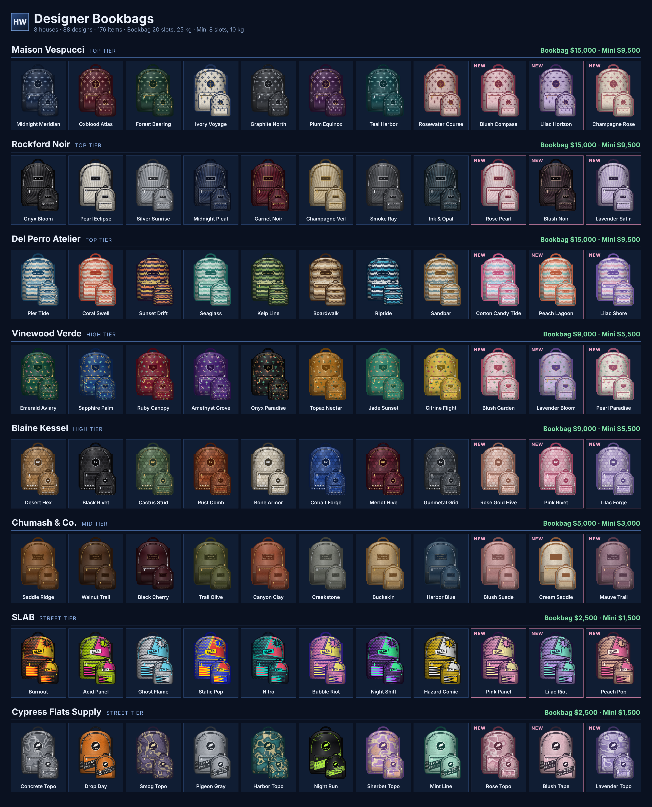

# Huncho Designer Bookbags

**Huncho Designer Bookbags** (`hunchoworld_bookbags`) adds wearable designer bookbags to your city. Every bag is its own inventory, sits on the player's back with real shoulder straps, and is sold from boutiques you set up in game.

* **8 fashion houses, 88 designs**, including 24 made for women
* **Two sizes:** bookbag (20 slots, 25 kg) and mini bookbag (8 slots, 10 kg)
* **176 items and images, 528 custom 3D props**, ready to stream
* **Three wear styles:** on the back, on the chest or one strap
* **In-game shop creator** with per-house pricing
* **Auto-detects** Qbox, QBCore, ESX and 8 inventories, with a bridge for your own


**Get it:** [Huncho World FiveM Store](https://huncho-world-fivem-store.tebex.store/)\
**Support & updates:** [Huncho World Discord](https://discord.gg/hP8VTtwgs5)


`Qbox` · `QBCore` · `ESX` · `ox` · `qb` · `qs` · `wasabi` · `tgiann` · `ak47` · `+ your own`

All houses, names and patterns are original and lore friendly.


New to the script? Start with [Installation](getting-started/installation.md).

