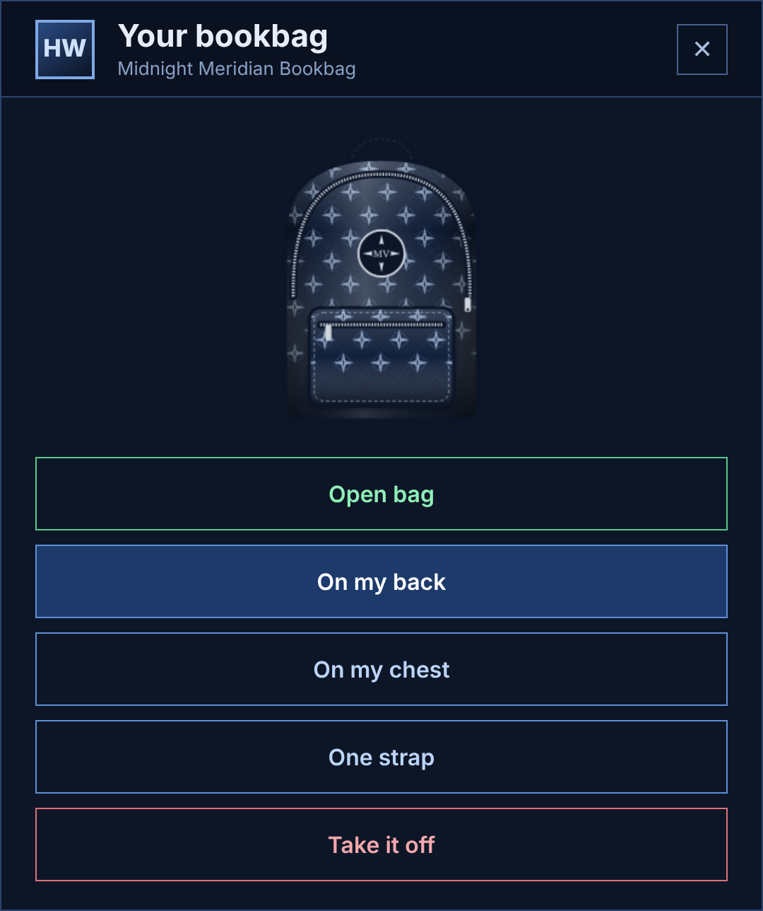

# Wearing bags

* **Put it on:** use a bag from the inventory and pick **On my back**, **On my chest** or **One strap**.
* **Open it:** press F7, type `/bag`, or use the worn bag and choose **Open bag**.
* **Change style or take it off:** use the worn bag again, or type `/bagstyle`.
* **One bag at a time:** take the current bag off before putting another on.
* **Contents stay with the bag.** Each bag has its own ID, so trading or dropping it keeps what is inside.
* **Bags can't go inside bags.** The script blocks it, or moves the bag back to the player if the inventory allows it.
* **It stays on.** A worn bag comes back after relogging and server restarts. Each character remembers its own bag.
* If a worn bag leaves the player's inventory, it comes off their back.
