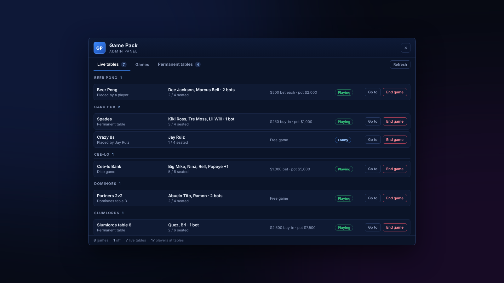
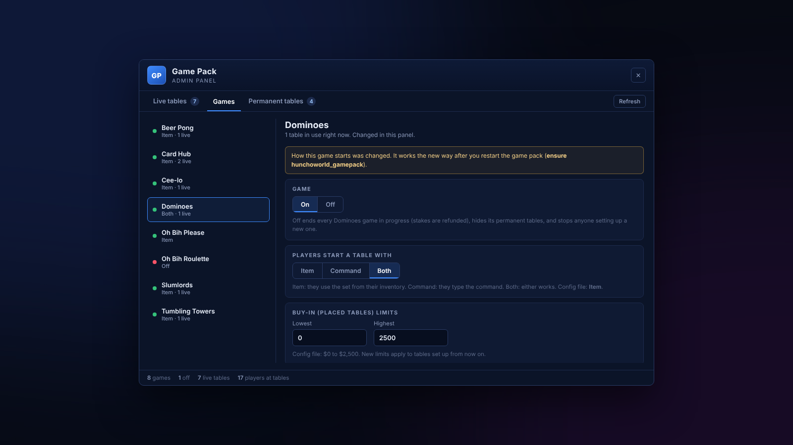
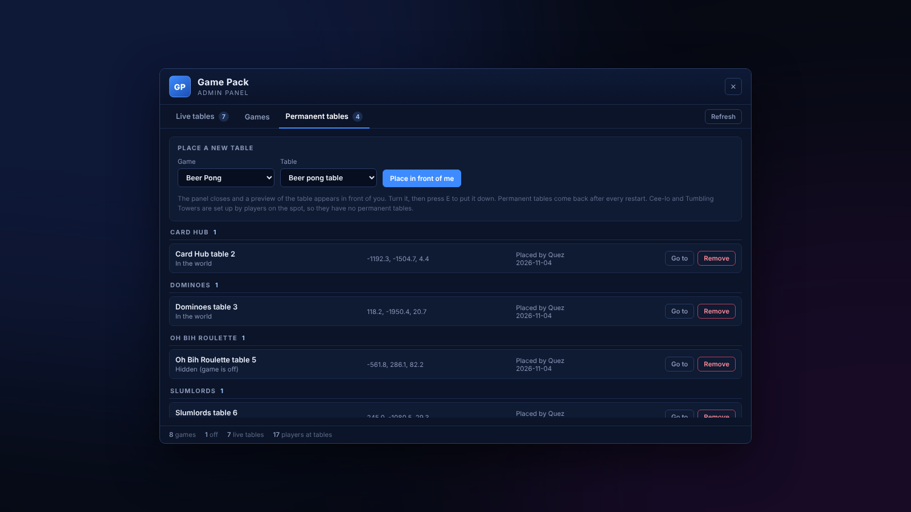

# Admin panel

Open it in game with **`/gamepack`**. By default only server admins (`group.admin`) can open it.

## Live tables

Every table someone is sitting at, in every game: what's being played, who's seated, bots, the stake and the pot. The list refreshes every 5 seconds.

* **Go to** teleports you next to the table.
* **End game** stands everyone up and refunds every stake on the table.

<figure><figcaption><p>Live tables</p></figcaption></figure>

## Games

Pick a game on the left to change it.

| Setting | What it does |
| --- | --- |
| **On / Off** | Off ends every game of it in progress (stakes refunded), hides its permanent tables and stops anyone setting up a new one. Players who try get "*Game* is closed right now." |
| **Players start a table with** | **Item**, **Command** or **Both**. |
| **Stake limits** | The lowest and highest stake hosts can pick. Oh Bih Please and Oh Bih Roulette have no real-money stakes. |
| **Reset to config file** | Drops your panel changes for that game and goes back to its config file. |

<figure><figcaption><p>Games</p></figcaption></figure>


On/off and stake limits apply straight away. A change to **how a game starts** (item / command / both) fully applies after you restart the pack (`ensure hunchoworld_gamepack`). The panel shows a yellow notice until you do.


## Permanent tables

Tables you place yourself that come back after every restart. Available for Beer Pong, Card Hub, Dominoes, Oh Bih Please, Oh Bih Roulette and Slumlords. Cee-lo and Tumbling Towers are set up by players on the spot, so they don't have permanent tables.

1. Pick the game and the table model.
2. Press **Place in front of me**. The panel closes and a preview of the table appears.
3. Turn it with the **arrow keys** or **mouse wheel**, then press **E** to put it down (**Backspace** cancels).

From the list you can **Go to** or **Remove** any permanent table. Removing one ends any game on it and refunds the stakes.

<figure><figcaption><p>Permanent tables</p></figcaption></figure>

## Where the settings are saved

Everything you change in the panel is saved in the server's resource storage (KVP), not in the resource folder. It survives restarts and updating the pack.

## Config

`games/admin/config.lua`:

```lua
Config.Language = nil            -- one language for every game and this panel (see Languages)
Config.Command  = 'gamepack'     -- opens the panel
Config.Ace      = 'group.admin'  -- ace group allowed to use it
Config.Title    = 'Game Pack'    -- title bar text
Config.Badge    = 'GP'           -- badge text when there's no logo
Config.Logo     = nil            -- or an image in games/admin/html/, e.g. 'img/logo.png'
Config.Log      = true           -- print admin actions in the server console
```

To let another group open it, change `Config.Ace`, or add the ace yourself:

```cfg
add_ace group.mod command.gamepack allow
```
