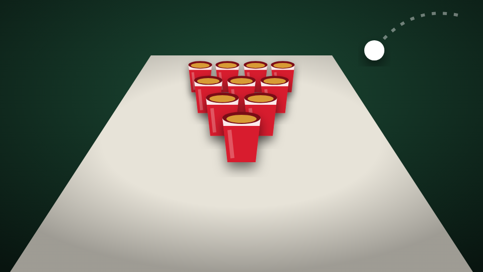

# Beer Pong

<figure><figcaption></figcaption></figure>

| | |
| --- | --- |
| **Item** | `beerpong_kit` (Beer Pong Kit) |
| **Command** | `/beerpong` |
| **Players** | 1v1 or 2v2, bots for open spots |
| **Files** | `games/beerpong/` |

## Setting up

Use the **Beer Pong Kit** or type `/beerpong`. The table appears in front of you, long side pointing away. Pack it up from the target menu or the lobby; the kit comes back.

**Lobby:** the first player to join hosts. They pick 6 or 10 cups, 1v1 or 2v2, re-racks, a bet and the house rules. Everyone else presses **Ready**, then the host starts. Add a bot (Easy, Normal, Hard or Pro) to any open spot.

## Controls

| Input | Does |
| --- | --- |
| Mouse | Aim |
| Scroll | Arc, from a flat line drive to a high lob |
| Hold left mouse | Power meter. Release in the green zone |
| Right mouse | Cancel the throw |
| **R** | Call a re-rack at the start of your turn |
| Hold **X** or `/beerpongleave` | Leave the game |
| **E** (watching) | Switch between broadcast, orbit and ball cam |

## How it plays

* **Rules:** bounce shots take two cups, balls back, heating up and on fire, re-racks, rebuttal, overtime, last cup slides to the middle, throw clock. Each can be switched off.
* **Drinking:** when a cup goes in, the defender drinks it. Every drink makes their meter faster and their aim sway.
* **Bots** line up, throw, drink and react, and play by the same physics as players. Money bets are off in bot games unless you allow them.
* **Betting:** the host sets a bet per player and the winners split the pot. Watchers can place side bets before the game starts. Unfinished games are refunded if the resource stops.
* **Watching:** pick **Watch the game** from the target menu or lobby.

## Config

| File | What's in it |
| --- | --- |
| `config/config.lua` | Integrations, setup method, props, permanent tables, house rules, betting, bots, drinking, colours |
| `config/advanced.lua` | Physics, accuracy, power meter, aiming, camera, animations, controls |
| `config/server.lua` | Discord logs and admin groups (server only) |
| `locales/*.lua` | Every word players see, including team names |
| `bridge/server.lua`, `bridge/client.lua` | Framework, inventory, money, notifications, prompts, HUD hooks |

* **Item, command or both:** `Config.Setup.method`, or the [admin panel](../admin-panel.md).
* **Highest bet:** `Config.Betting.maxBet`, or the admin panel.
* **Permanent tables:** `Config.Locations` (`spawn = false` uses a table already in the map), or the admin panel.
* **Better props:** put a streamed beer pong table and red cup in `Config.Models`. Sizes are measured from the models, so the physics always matches.
* **Difficulty:** raise `Config.Accuracy.baseSpread` to make it harder.

## Permissions

```cfg
add_ace group.admin hunchoworld_beerpong.admin allow   # pack up anyone's table
add_ace group.vip   hunchoworld_beerpong.place allow   # only if Config.Setup.commandAce = true
add_ace group.vip   hunchoworld_beerpong.bots  allow   # only if Config.Bots.ace = true
```

## For developers

```lua
exports.hunchoworld_gamepack:IsPlaying()              -- in a lobby, a game, or watching
exports.hunchoworld_gamepack:IsBeerPongTable(entity)
exports.hunchoworld_gamepack:IsNearBeerPongTable(3.0)
```

State bag `inBeerPong` (`LocalPlayer.state.inBeerPong` / `Player(src).state.inBeerPong`). Hooks in `bridge/client.lua` (`OnEnterGame`, `OnLeaveGame`) and `bridge/server.lua` (`OnGameEnd`, `OnTablePlaced`, `OnTableRemoved`).
