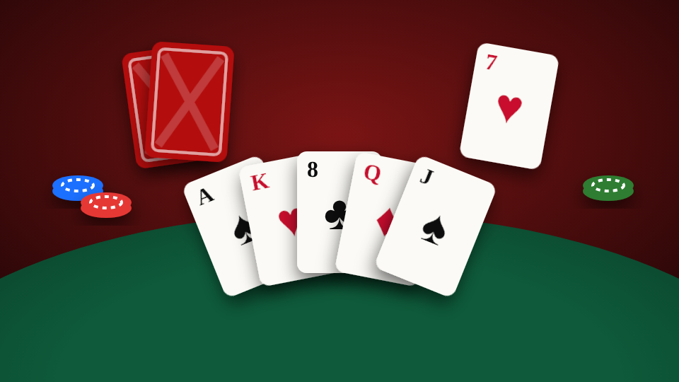

# Card Hub

<figure><figcaption></figcaption></figure>

| | |
| --- | --- |
| **Item** | `card_table` (Card Table) |
| **Command** | `/placetable` |
| **Games** | Crazy 8s, Last Card (Uno-style, custom deck), Spades (2v2), Tonk, Go Fish |
| **Files** | `games/cardhub/` |

## Setting up

* Walk up to any table prop in `Config.TableModels`, or a placed card table, and pick **Deal in**.
* Place your own table with the **Card Table** item or `/placetable`: aim the preview, **scroll** to rotate, **E** to place, **Backspace** to cancel. Pick it back up from the table menu.
* At an empty table, pick the game, **Free** or a **buy-in**, and **Stand** or **Sit**.

## How it plays

* Everyone who sits pays the same buy-in. The winner takes the pot (Spades: the winning team splits it; ties split it).
* **Leave before the deal:** full refund. **Walk off or disconnect mid-game:** your buy-in stays in the pot.
* Run out the turn timer and the table plays a move for you.
* **Bots:** the host can fill empty seats. Free tables only by default (`Config.Bots.allowOnMoneyTables`).
* **Cards on the table:** everyone's cards lie in front of them. You see yours face-up and everyone else's as backs with their real count. Played cards land on the real pile.

## The table panel

Docked at the bottom of the screen. Drag it by the top bar, resize with **− / +**, or switch to **Mini** to show only your hand. **Look** frees the camera; **E**, **Backspace** or a left click brings the cursor back.

## Admin

| Command | Does |
| --- | --- |
| `/cardtable [model]` | Place any prop as a card table |
| `/removecardtable` | Remove the nearest placed table, even mid-game (everyone refunded) |

Admins are the `Config.Admin.ace` group plus `Config.Admin.groups`.

## Config

| File | What's in it |
| --- | --- |
| `config.lua` | Games, money, bots, tables, placement, seating, visuals, compatibility |
| `config_server.lua` | Discord webhook (server only) |
| `locales/*.lua` | Every line of text, including each game's rules |
| `shared/rules.lua` | Which cards appear on each rules row |
| `editable/server.lua`, `editable/client.lua` | Custom framework, money, items, notifications, prompts, sit/stand hooks |

* **Item, command or both:** `Config.Placement.method` (`'off'` = players can't place, admins still can), or the [admin panel](../admin-panel.md).
* **Buy-in limits:** `Config.Money.min` / `max`, or the admin panel.
* **Turn a game off:** `Config.Games.<game>.enabled = false`. Free only: `allowStakes = false`.
* **Your card back:** `Config.TablePlay.cardBack` (colours and logo).
* **Chairs facing the wrong way:** `Config.Seating.chairTurn`. Too high or low: `seatHeight`.

Player-placed tables are saved in `games/cardhub/data/tables.json`.
