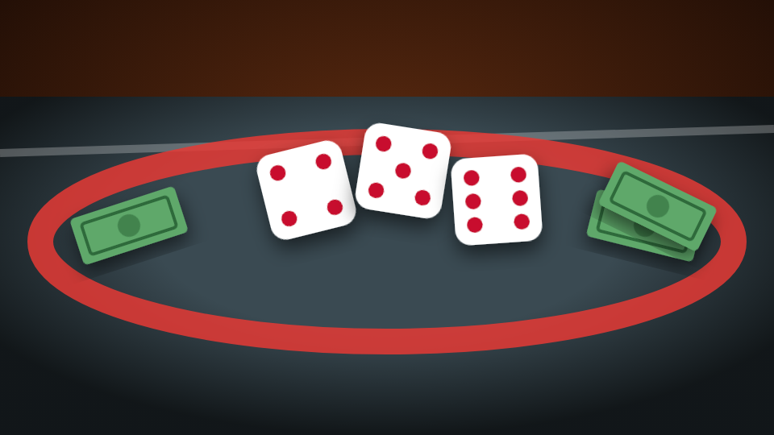

# Cee-lo Street Dice

<figure><figcaption></figcaption></figure>

| | |
| --- | --- |
| **Item** | `ceelo_dice` (Dice) |
| **Command** | `/ceelo` |
| **Games** | Cee-lo Bank, Head-Up, Pot Run, Street Craps, Over/Under 7, Pig |
| **Files** | `games/ceelo/` |

## Controls

| Key / command | Does |
| --- | --- |
| `/ceelo` or the **Dice** item | Open "set the table": pick a game, a bet, or free play with bots |
| **E** near a ring | Join |
| **G** | Host / shooter starts the round |
| **E** on your turn | Pick up the dice, shake, throw |
| **X** | Leave between rounds (full refund). In Pig: bank your turn |
| `/ceelorules` | Rules for every game |

Players can rebind keys in *Settings → Key Bindings → FiveM*.

## The games

* **Cee-lo Bank:** one banker covers the table. 4-5-6 or trips takes the table, 1-2-3 pays everyone, a point means every fader rolls to beat it.
* **Head-Up:** one on one, best of three.
* **Pot Run:** everyone antes and gets two lives. Lowest roll loses a life. Last one standing takes the pot.
* **Street Craps:** 7 or 11 wins on the come-out, 2, 3 or 12 loses, anything else is the point.
* **Over/Under 7:** one player is the house; everyone picks a side. Exactly 7 pays 4 to 1.
* **Pig:** one die, bank your turn before a 1 wipes it. First to 100 takes the pot.

## Money and safety

* **Bets are held in escrow** from the moment a player commits until the round settles.
* **The server rolls the dice.** Clients only animate what it decided.
* **Leaving between rounds** refunds everything. **Leaving mid-round** (walking more than 10 m away or logging out) forfeits.
* **Offline players still get paid** on their next login, including after a restart.
* **What players bet with:** `Config.Money.account` (cash, bank, ESX black money, or any item).

## Free play and bots

Turn on **Free play** when setting the table. The host can add up to 5 bots, who kneel, scoop the dice, throw and react. Bots only sit at free tables.

## Admin

`/ceeloclose` closes the nearest table and refunds every bet:

```cfg
add_ace group.admin command.ceeloclose allow
```

## Config

| File | What's in it |
| --- | --- |
| `config.lua` | Every setting |
| `locales/*.lua` | Every message, prompt, panel line and rules card |
| `custom/server.lua` | Discord webhook, police dispatch, who may open tables and where, round-end hook |
| `bridge/server.lua`, `bridge/client.lua` | Framework, inventory, money, notifications, key prompts |

* **Item, command or both:** `Config.Start.method`, or the [admin panel](../admin-panel.md).
* **Bet limits:** `Config.Money.minBet` / `maxBet`, or the admin panel.
* **Dice:** drawn in the world, so no streaming is needed. Size and colours in `Config.Dice.drawn`. A custom 3D model is optional (`install/custom_dice_model/`).
