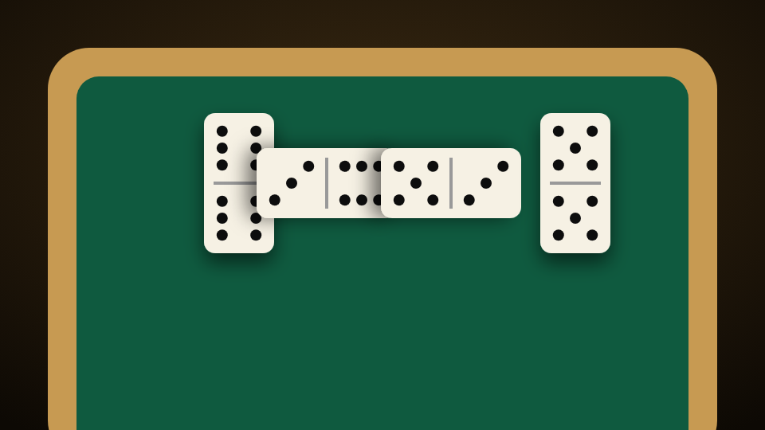

# Dominoes

<figure><figcaption></figcaption></figure>

| | |
| --- | --- |
| **Item** | `domino_table` (Domino Table) |
| **Command** | `/dominotable` |
| **Modes** | Partners 2v2, Caribbean 500, Draw, Block, All Fives, All Threes, Bergen, Mexican Train (up to 8 players) |
| **Files** | `games/dominoes/` (props in the pack's `stream/`) |

## How players use it

* **Sit:** target a chair or walk up and press **E**. The first player down hosts: they pick the mode, stakes and bots, everyone readies up, and the host deals.
* **Wash:** on your deal, hold **left mouse** and sweep across the felt, then press **Done washing**.
* **Play:** lit tiles are playable. Click one; if it fits more than one end, click the glowing spot. Click the boneyard to draw, the red ring to knock.
* **Drinks:** order one from the lobby or seat menu. Sip with **G** or by clicking your cup.
* **Watch:** target a table with a game on → **Watch the game**.
* **Placed tables:** use the item, scroll to rotate, click to place. The owner packs it up from the lobby or the target menu once nobody else is seated.

| Key | Does |
| --- | --- |
| **M** | Seat menu: camera, FOV, table / 2D board, customize, rules, get up |
| **H** | Hide the HUD |
| **D** | Draw |
| **K** / **Space** | Knock |
| **Esc** / **E** | Hide / show the UI |

## Features

* The case opens, the tiles pour out face down, and the dealer washes them by hand while everyone watches.
* Real props: a domino table with rails and cup holders, a hinged case in three finishes, tiles in five styles.
* Drinks in the cup holders, with optional items and thirst (QBCore / Qbox / ESX).
* Cameras: Lean in, First person, Shoulder and Free look.
* Customize the table: felt colours, Puerto Rico / Dominican Republic / Cuba flag tops, your logo, tile style, case finish.
* Stakes: a buy-in pot with an optional house cut, per-point payouts held up front, or both.

## Config

| File | What's in it |
| --- | --- |
| `config/main.lua` | Framework, money, branding (felt label and logo), timers, bots, drinks, keys. **Start here.** |
| `config/tables.lua` | Fixed tables, allowed modes and stakes per table, the placeable table item |
| `config/modes.lua` | Rules for every mode |
| `config/advanced.lua` | Cameras, models, tile colours, animations, bot names and peds |
| `locales/*.lua` | Every message, prompt, rules text and UI label |

* **Item, command or both:** `Config.TableItem.method`, or the [admin panel](../admin-panel.md).
* **Buy-in limits (placed tables):** `Config.TableItem.stakes.buyIn`, or the admin panel.
* **Fixed tables:** uncomment the example in `config/tables.lua`, or place [permanent tables](../admin-panel.md#permanent-tables) in the admin panel.
* **Your logo on the felt:** `Config.Mat.image` and `Config.Mat.label`.


**Old GTA table and flat tiles instead of the domino table?** The streamed models didn't load. Make sure the pack's `stream/` folder is intact. The F8 console says `prop pack found` when they load.

