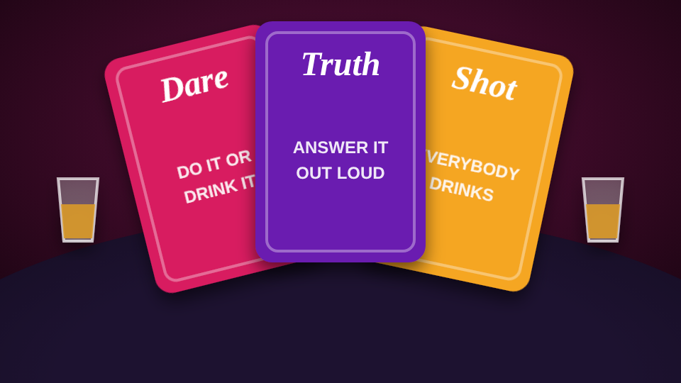

# Oh Bih Please

<figure><figcaption></figcaption></figure>

| | |
| --- | --- |
| **Item** | `ohbihplease_deck` (Oh Bih Please Deck) |
| **Command** | `/ohbihplease` |
| **Cards** | 130 Truth, Dare, Shot and Wild cards, Clean or Spicy |
| **Files** | `games/ohbihplease/` |

## How players use it

* **Set up a table:** use the deck or type `/ohbihplease`. Pick a table (4 or 6 seats), aim, scroll to rotate, **E** to place. The owner packs it up from the table menu once nobody is sitting.
* **Sit down:** the first one down hosts. They pick **Clean / Spicy** and **Quick / Standard / Full deck**, add bots, and start.
* **Your turn:** draw. **Truth:** answer out loud, then **Answered**. **Dare:** do it, then **Completed**. Or **Skip & drink**.
* **Cap:** after a truth, everyone else has a few seconds to call **Cap** or **Fair**. Majority cap and they drink anyway.
* **Look around:** the eye button (or **Esc**) frees your mouse; **E** brings the cursor back.
* Players can sit down or get up mid-game.

## Features

* Wild cards: reverse, skip, drinking buddies, shields and house rules.
* Shot glasses at every seat; the glass slides into your hand for every drink.
* Light drunk effects that build with drinks and wear off.
* Bots that draw, do dares, drink, vote and call cap.
* End-of-night awards: Heavyweight, Legend of the Night, Cap Collector, Stone Cold Sober.

## Config

| File | What's in it |
| --- | --- |
| `config.lua` | Players, spicy cards, game lengths, drink penalties, timers, drunk effects, bots, table styles, placement |
| `config_deck.lua` | Every card, one deck per language. Card types are explained at the top |
| `config_server.lua` | Discord webhook (server only) |
| `locales/*.lua` | Every word players see |
| `editable/client.lua` | Notifications, prompts, sit/stand hooks, **OnDrink** for your own drunk script |
| `editable/server.lua` | Custom framework hooks, **OnGameEnd** (XP, stress relief), logs |

* **Item, command or both:** `Config.Placement.method`, or the [admin panel](../admin-panel.md).
* **Permanent tables:** `Config.Tables`, or the admin panel.
* **Drunk effects:** `Config.Drunk.perDrink` and `max`. `builtIn = false` uses only your own script.
* **Admin:** `/removeobptable` removes the nearest player-placed table.
