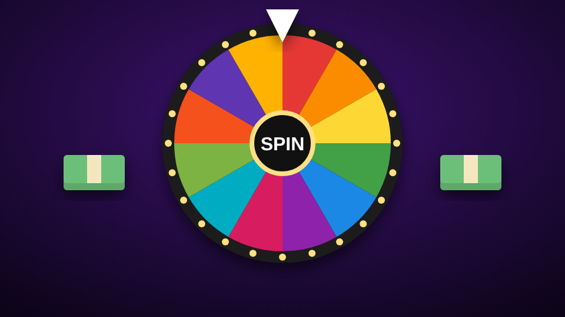

# Oh Bih Roulette

<figure><figcaption></figcaption></figure>

| | |
| --- | --- |
| **Item** | `bihroulette_wheel` (Oh Bih Roulette Wheel) |
| **Command** | `/bihroulette` |
| **Modes** | Dare or Pay (play-money racks), Party (no money) |
| **Files** | `games/bihroulette/` |

## How players use it

* **Set up a table:** use the wheel or type `/bihroulette`. Pick a table (4 or 6 seats), aim, scroll to rotate, **E** to place.
* **Sit down:** the first one down hosts. They pick **Dare or Pay / Party**, **Clean / Spicy** and **Quick / Standard / Long** (20 / 40 / 60 spins), add bots, and start.
* **Your turn:** hit **SPIN**. Everyone sees where it lands. Answer the truth, do the dare, or skip it: **Pay** racks (Dare or Pay) or **Drink**.
* **Cap:** after a truth, everyone else can call **Cap** or **Fair**. Majority cap and they drink anyway.

## The wheel

| Slice | What happens |
| --- | --- |
| Truth / Dare | Answer it or do it, or skip |
| Take a Shot | Somebody drinks |
| Wild Card | Reverse, skip, drinking buddies, shields, house rules, Snatch, Tax Day |
| Hot Seat | The table votes "who's most likely to..." |
| Give Out / Social | Hand out drinks / everyone drinks |
| Spin Again | Spin again |
| Make It Rain | The bank pays you racks (Dare or Pay) |
| Pay Up | You pay racks into the pot (Dare or Pay) |
| Jackpot | You take the whole pot (Dare or Pay) |

Put a slice in twice in `Config.Wheel` to make it come up more often.


**Racks are not real money.** They only exist inside one game. To reward the winner with real cash, use `EditableServer.OnGameEnd` in `editable/server.lua`.


## Config

| File | What's in it |
| --- | --- |
| `config.lua` | Players, modes, racks, the wheel (slices and colours), timers, drunk effects, bots, table styles, placement |
| `config_deck.lua` | Every card, in piles the wheel draws from, one deck per language |
| `config_server.lua` | Discord webhook (server only) |
| `locales/*.lua` | Every word players see, including the slice names |
| `editable/client.lua`, `editable/server.lua` | Notifications, prompts, **OnDrink**, **OnGameEnd**, logs |

* **Item, command or both:** `Config.Placement.method`, or the [admin panel](../admin-panel.md).
* **Your logo in the middle of the wheel:** put the image in `html/` and set `Config.TableWheel.logo`.
* **Permanent tables:** `Config.Tables`, or the admin panel.
* **Admin:** `/removeobrtable` removes the nearest player-placed table.
