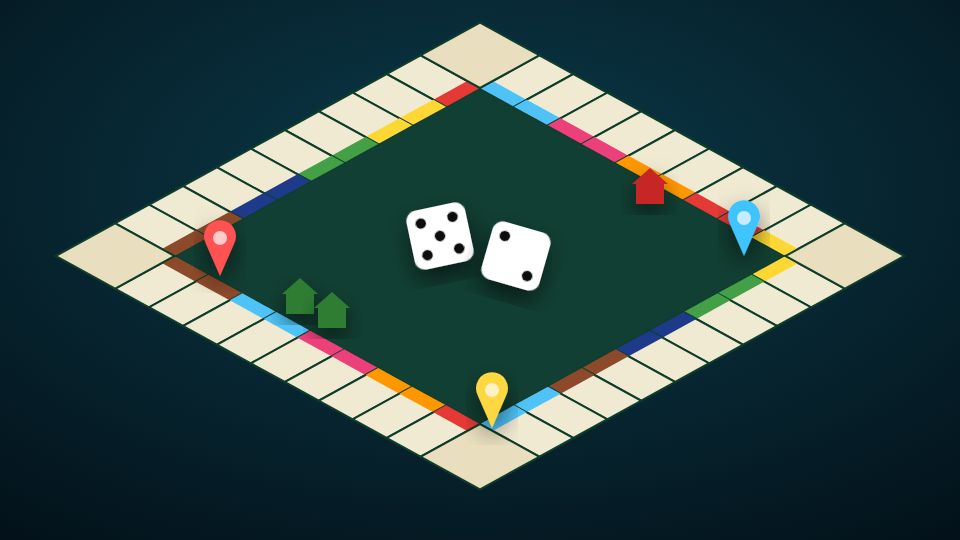

# Slumlords

<figure><figcaption></figcaption></figure>

| | |
| --- | --- |
| **Item** | `slumlords_board` (Slumlords Board Game) |
| **Command** | `/slumlordstable` |
| **Players** | 2 to 6, bots for empty seats |
| **Files** | `games/slumlords/` |

## How players use it

* **Set up a table:** use the board game item. Aim the preview, **scroll** to rotate, **E** to place, **Backspace** or right-click to cancel.
* **Sit:** target a chair or walk up and press **E**. The first player down hosts.
* **Lobby:** the host picks a buy-in (or Free) and can add bots. Everyone presses **I'm ready**; the host presses **START GAME**.
* **Play:** **ROLL**, then buy or auction, build from **Properties**, deal with **Trade**, and **END TURN**. Click any square to see its deed.
* **Views:** **Table view** looks at the real table from your chair; **Board view** shows the full board. **F6** hides or shows the panel.
* **Get up:** before the game starts, full refund. Mid-game, you forfeit your buy-in.
* **Watch:** walk up to a running game and press **H**, or target it → **Watch the game**.
* **Pack up:** when nobody's seated, the owner targets the table (or presses **G**) to get the item back.

After a game, the table goes back to the lobby with everyone still seated.

## Features

* The live board is printed on the tabletop, with owned squares glowing in the owner's colour.
* 3D dice thrown from the player's hand; 3D pins, houses and hotels.
* Full rules: auctions, rent, even building, a limited house and hotel supply, mortgages, metro stations, utilities, taxes, jail, two card decks, trades, bankruptcy.
* Buy-in pot with an optional house cut. In-game Slumlords cash is never real money.
* Turn timer with safe auto-moves and an optional time limit.

## Admin

Admins have the ace `sage_slumlords.admin` or a group in `Config.Admin.groups`.

```cfg
add_ace group.admin sage_slumlords.admin allow
```

| Command | Does |
| --- | --- |
| `/slumlordsadmin` | Place a table anywhere, no item, no limit |
| `/slumlordsremove` | Remove the nearest table, even mid-game. Every buy-in is refunded |

## Config

| File | What's in it |
| --- | --- |
| `config/main.lua` | Framework, the table item, fixed tables, money and buy-ins, rules, timer, bots, keys, admin. **Start here.** |
| `config/advanced.lua` | Table styles, seating, the board on the table, camera, dice, bot names, player colours |
| `config/server.lua` | Discord webhook (server only) |
| `locales/*.lua` | Every line of text, plus translated squares and cards |
| `shared/board.lua` | Square names, prices, rents, building costs, pictures and both card decks |

* **Item, command or both:** `Config.TableItem.method`, or the [admin panel](../admin-panel.md).
* **Buy-in limits:** `Config.Money.min` / `max`, or the admin panel.
* **House rules:** `Config.Rules` (starting cash, START LINE payout, bail, building supply, auctions, Vinewood Valet pot, time limit).
* **Permanent tables:** `Config.Tables`, or the admin panel.
