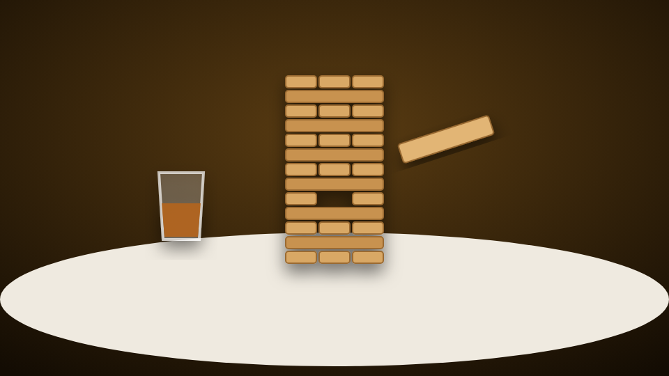

# Tumbling Towers

<figure><figcaption></figcaption></figure>

| | |
| --- | --- |
| **Item** | `tumbling_towers` (Tumbling Towers Set) |
| **Command** | `/tumblingtowers` |
| **Players** | Up to 6, NPCs for empty seats |
| **Files** | `games/towers/` |

## How it plays

1. **Host** uses the set (or types `/tumblingtowers`). A see-through table and chairs follow where you look: **scroll** or the arrow keys rotate, **E** places, **Backspace** cancels.
2. **Menu tabs:** *Table* (seats, NPCs), *Stakes* (free or cash, shots before you're out), *Rules*.
3. **Other players** target a chair and pick *Sit down* (or walk up and press **E**), then *Accept and play*.
4. The host presses **Start**. Cash stakes are taken from everyone and your view moves to your chair.
5. **Your turn:** click a block to slide it out, then click a glowing slot on top to set it down.
6. Knock the tower over and you **take a whiskey shot** in your chair. The tower is rebuilt and the next player goes first.
7. The host sets how many shots everyone can take: **Sudden death (0)**, 1, 2, 3, 4, 5, 7 or 10. **Fewest shots wins** (ties split the pot).
8. **Results:** the host can **Run it back** or close the table.

## Controls

| Input | Does |
| --- | --- |
| **A / D**, arrow keys, or right-mouse drag | Turn the tower |
| **W / S** or mouse wheel | Lean in / out |
| **Q / E** | Lower / raise your view |
| Mouse | Look around while you wait |
| **X** | Back to your chair |
| **G** (walking past) | Watch the game |
| **Backspace** twice | Stand up (forfeits your stake mid-game) |

If the host leaves, the table closes and stakes are refunded.

## Config

Everything is in `config.lua`; text is in `locales/*.lua`.

* **Item, command or both:** `Config.Item.method`, or the [admin panel](../admin-panel.md).
* **Bet limits:** `Config.MinBet` / `Config.MaxBet`, or the admin panel.
* **Shot options:** `Config.ShotLimits`, default `Config.DefaultShotLimit`.
* **Camera:** `Config.Camera` (eye height, lean, turn limits, `orbitAlways`, watcher distance).
* **Watching:** `Config.Spectate`.
* **Designs:** Pine & Brass, Neon Arcade, Speakeasy Noir and Frosted Glass. Players pick one in the menu; `Config.DefaultTheme` sets the first-time look.
* **Block size:** `Config.Block.Scale` (0.45 = real tabletop blocks).
* **Difficulty:** `Config.Difficulty`, `Config.NpcMistake`, `Config.TurnTime`.


**First run tuning:** if chairs face away from the table, set `Config.ChairHeadingOffset = 180.0`. If players sit too close or far, use `/ttsit <back>` while seated and copy the number into `Config.SitBack`.

